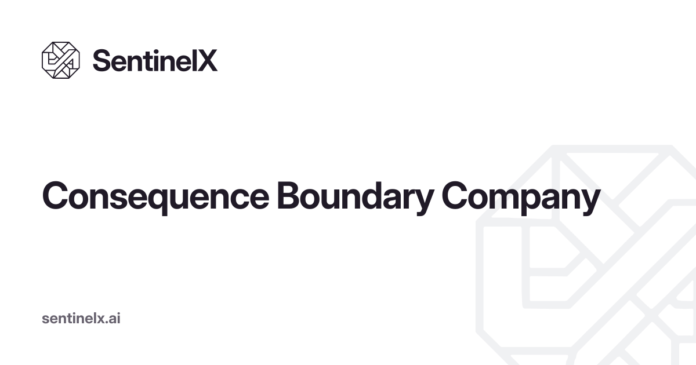

### Secure the action, not the prompt.

Agents act. SentinelX decides whether a protected action is allowed to commit, before it happens, and leaves evidence of the decision.

#### Official SDKs

| Language | Install |
|---|---|
| [TypeScript](https://www.npmjs.com/package/@sentinelx/sdk) | `npm install @sentinelx/sdk` |
| [Python](https://github.com/Sentinelxai-dev/sentinelx-py) | `pip install sentinelx-sdk` |
| [Rust](https://github.com/Sentinelxai-dev/sentinelx-rs) | `cargo add sentinelx` |
| [Go](https://github.com/Sentinelxai-dev/sentinelx-go) | `go get github.com/Sentinelxai-dev/sentinelx-go` |

SentinelX v3 is coming soon.

© 2026 SentinelXAI, Inc.
